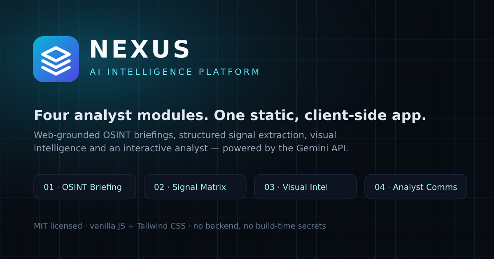

<div align="center">



# NEXUS

**A client-side AI intelligence workspace.**
OSINT briefings, structured signal extraction, visual intelligence and an
interactive analyst — in one static app routed through the
[Coarena](https://coarena.ai) model gateway: one free key, 24 models.

**The interface is Persian (RTL).** Brand names, model ids and the OpenAI-compatible
wire contract stay Latin; everything an analyst reads is Farsi.
**رابط کاربری کاملاً فارسی و راست‌به‌چپ است.**

**Live:** <https://nexus-alib11.vercel.app/>

[](https://github.com/AliB11/Nexus/actions/workflows/ci.yml)
[](./LICENSE)
[](https://nodejs.org)
[](https://prettier.io)
[](./tests)
[](./docs/ARCHITECTURE.md)

**No backend · no bundler · no runtime dependencies · MIT licensed**

</div>

---

## What it does

| Module                  | What you get                                                                                                                                                                                               | Wire feature                      |
| ----------------------- | ---------------------------------------------------------------------------------------------------------------------------------------------------------------------------------------------------------- | --------------------------------- |
| **01 · OSINT Briefing** | Executive-ready intelligence report on any topic. Four analyst presets (semiconductors, cyber, grid storage, AI regulation). With clickable, verified citations when the gateway supports live web search. | grounding (Google transport only) |
| **02 · Signal Matrix**  | Turn raw text — or a finished briefing — into a strict JSON assessment: threat level, sentiment, confidence score, entities, opportunities, risks and action items.                                        | enforced JSON schema              |
| **03 · Visual Intel**   | Upload a chart, document scan or photo (drag & drop, ≤ 8 MB) and get a directive-driven analysis: comprehensive brief, quantitative chart extraction, OCR, or anomaly inspection.                          | vision (inline base64)            |
| **04 · Analyst Comms**  | Multi-turn conversation with a senior-analyst persona, bounded history, citations when the gateway can ground them.                                                                                        | multi-turn chat                   |

> Live web grounding is a Google Search tool that exists only on the direct Gemini
> transport. On Coarena the app says so in a toast instead of implying citations
> that were never fetched — switch the gateway in the settings dialog if verified
> sources matter more than model choice.

Plus: dark/light themes, a local dossier archive, copy-to-clipboard on every
report, print styles for archiving briefings, UTC telemetry clock, toasts instead
of `alert()`, and a responsive RTL shell with a mobile drawer.

## Quick start

```bash
git clone https://github.com/AliB11/Nexus.git
cd Nexus
npm install
npm run dev            # → http://localhost:5173
```

Then:

1. The settings dialog opens on first run. It has three fields — **API key**
   (free at [Coarena](https://coarena.ai/account/api/keys), `coa_…`), **URL**
   (`https://coarena.ai/api/v1`) and **model** (`gemini-3-8-flash`) — plus a
   gateway selector. Everything is stored only in your browser's `localStorage`.
2. Press **تست اتصال** (test connection). It reads the gateway's model list, spends
   one token, and reports latency, the model that answered and a Persian
   explanation of any error code — before you save anything.
3. Save. The sidebar chip turns **تنظیم‌شده** and shows `Coarena · GEMINI 3.8 FLASH`.
4. Try _Module 01 → Semiconductor Supply Chain_, then push that briefing into
   Module 02 with **ارسال به ماتریس**.

> The app is a static site, so `npm run dev` (or `npm run build && npm run preview`)
> is required — opening `src/index.html` over `file://` will not load ES modules.

## Scripts

| Command           | What it does                                                                                                     |
| ----------------- | ---------------------------------------------------------------------------------------------------------------- |
| `npm run dev`     | Build, serve on `:5173` and rebuild on change                                                                    |
| `npm run build`   | Compile Tailwind + copy source into `dist/`                                                                      |
| `npm run preview` | Serve the production build on `:4173`                                                                            |
| `npm run proxy`   | Local pass-through proxy for the gateway, with CORS headers — the fallback if the browser is blocked (see below) |
| `npm run lint`    | ESLint (flat config, per-layer browser/node globals)                                                             |
| `npm run format`  | Prettier write                                                                                                   |
| `npm run verify`  | Static integrity: DOM ids ↔ markup, import graph, exports, bus actions, key leaks                                |
| `npm test`        | 150 tests via the built-in Node test runner (unit + jsdom boot smoke test)                                       |
| `npm run check`   | Everything above, in CI order                                                                                    |
| `npm run assets`  | Re-rasterise brand PNGs from `assets/brand/*.svg` (optional dependency)                                          |

## Project structure

```
src/
├── index.html            Shell + the four module panels + settings dialog
├── styles/main.css       Tailwind layers, scrollbars, print, reduced motion
└── js/
    ├── config.js         Every tunable default (overridable at runtime)
    ├── main.js           Boot sequence
    ├── core/             dom · state · bus · sanitize · markdown · prompts ·
    │                     theme · navigation · toast · clipboard · format ·
    │                     history · clock
    ├── api/              errors.js (shared error type, backoff, error parsing)
    │                     openai.js (Chat Completions — Coarena and any
    │                     OpenAI-compatible gateway)
    │                     gemini.js (Gemini generateContent — direct Google key)
    │                     provider.js (neutral request/result mapping)
    ├── services/         provider.js (gateway routing + connection test)
    │                     settings.js (provider, key, URL, model) · dossiers.js
    ├── ui/               settings-dialog.js
    └── modules/          briefing.js · matrix.js · visual.js · comms.js

scripts/                  build · dev · serve · proxy · verify · generate-icons
tests/                    node:test suites for every pure layer
docs/                     ARCHITECTURE · CONFIGURATION · DEPLOYMENT
public/                   favicon, PWA icons, manifest, robots.txt, 404, OG image
.github/                  CI, Pages deploy, issue & PR templates, CODEOWNERS, Dependabot
```

Dependencies point inwards: `modules → core/services/api → config`. Modules never
import each other — they exchange named actions through a tiny bus
(`briefing:render`, `matrix:runFromText`, `apikey:prompt`), which keeps the graph
acyclic and each module independently testable.

**Full detail — layer responsibilities, data-flow diagrams for all four modules,
the security model, storage schemas and a guide for adding a fifth module:
[docs/ARCHITECTURE.md](docs/ARCHITECTURE.md).**

## Configuration

| Mechanism                | Scope          | Example                              |
| ------------------------ | -------------- | ------------------------------------ |
| Settings dialog (in-app) | one browser    | gateway, API key, base URL, model id |
| `window.NEXUS_CONFIG`    | one deployment | `{ api: { baseUrl: "/api/model" } }` |
| `src/js/config.js`       | one fork       | defaults, limits, storage keys       |

Details in [docs/CONFIGURATION.md](docs/CONFIGURATION.md).

## Deployment

`npm run build` emits a dependency-free `dist/`. Relative asset paths mean it
works at a domain root or under a sub-path.

- **GitHub Pages** — `.github/workflows/pages.yml` already builds and publishes on
  push to `main`; just set _Settings → Pages → Source: GitHub Actions_. If Pages is
  currently on “Deploy from a branch” it would publish the repository root instead
  of `dist/` — see the warning in [docs/DEPLOYMENT.md §2](docs/DEPLOYMENT.md#2-github-pages).
- **Vercel** — this repo is deployed at <https://nexus-alib11.vercel.app/>
  (project `nexus`, linked to `AliB11/Nexus`, build `npm run build`, output
  `dist`, install `npm ci`). See
  [docs/DEPLOYMENT.md §3](docs/DEPLOYMENT.md#3-vercel) for the two settings that
  differ from the dashboard defaults.
- **Netlify / Cloudflare Pages** — build `npm run build`, output `dist`.
- **Any static host / nginx / S3** — same folder; serve `.js` as `text/javascript`.
- **Browser blocked by CORS?** Run `npm run proxy` and set the URL field to
  `http://127.0.0.1:8787/api/v1` — see
  [docs/DEPLOYMENT.md §5.2](docs/DEPLOYMENT.md#52-if-the-browser-is-blocked-by-cors).
- **Your own key instead of the visitor's?** Put an edge function in front of the
  gateway and set `api.baseUrl` — see
  [docs/DEPLOYMENT.md §5.3](docs/DEPLOYMENT.md#53-keeping-a-key-off-the-client-your-project-pays).

## Security

- Model output is escaped before it ever reaches `innerHTML`; generated links are
  restricted to `http`/`https`/`mailto` (no `javascript:`/`data:`).
- The API key travels in an `Authorization: Bearer` **header** (or `x-goog-api-key`
  on the Gemini transport), never in a URL.
- No key is ever committed — `npm run verify` scans `src/`, `docs/` and `public/`
  for Coarena (`coa_…`), Google (`AIza…`), Anthropic and OpenAI key shapes, and
  fails the build on a hit.
- Coarena stores every prompt and reply sent through its Model API and may license
  them in datasets; that cannot be withdrawn. Do not paste sensitive personal data,
  passwords or keys into the app while that gateway is selected.
- Client-side means client-side: a public deployment should rely on
  visitor-supplied keys or a proxy. Read [SECURITY.md](SECURITY.md) before
  deploying with your own credentials.

## Contributing

Issues and pull requests are welcome — please read
[CONTRIBUTING.md](CONTRIBUTING.md) and follow the
[Code of Conduct](CODE_OF_CONDUCT.md). Bug reports and feature requests use
structured forms in `.github/ISSUE_TEMPLATE/`.

## History

Version 1.0 was a single 1,647-line HTML file with Tailwind's Play CDN and an
inline script that expected a host environment to inject an API key at runtime —
so it could not run standalone after a `git clone`. Version 2.0 keeps the same
design language, prompts and behaviour, but splits it into the layered structure
above, compiles the CSS, and adds a credential flow so the app works for anyone
who clones it. Version 2.2 makes the model gateway pluggable: Coarena is the
default (one free key, 24 models), direct Google AI Studio remains available, and
the settings dialog gained a URL field and a connection test. The v1 file remains in the git history (tag
[`v1.0.0-single-file`](https://github.com/AliB11/Nexus/tree/v1.0.0-single-file), commit `32a0bbb`).

## License

[MIT](LICENSE) © 2026 AliB11 and NEXUS contributors.
